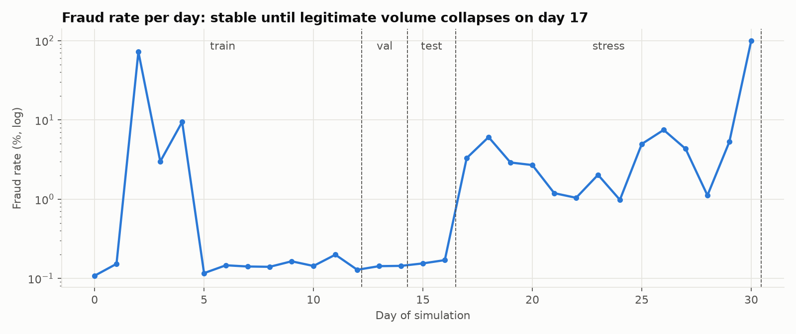
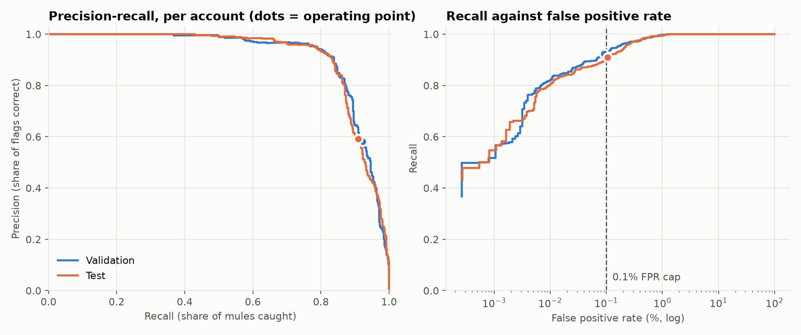
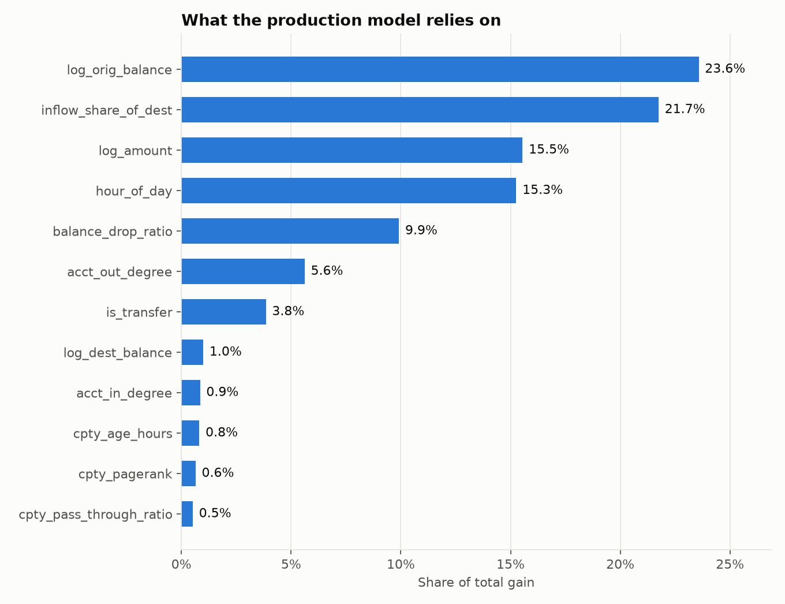
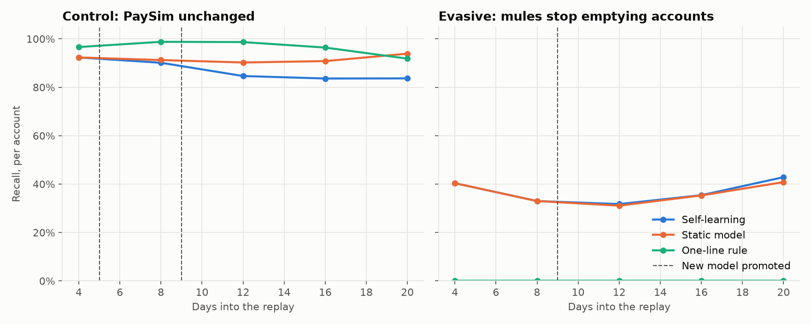

# Mule Account Flagger

Flags mule accounts in the [PaySim](https://www.kaggle.com/datasets/ealaxi/paysim1) mobile-money log (6.36M transactions) with a two-pass pipeline. A graph layer reads the relationships between accounts, a behavior layer reads the math of each transaction, and XGBoost makes the final call.

An optional [self-learning mode](#self-learning-mode-off-by-default) retrains the model on analysts' decisions once deployed with a bank. It is switched off, and the results below come from the static system.

## Result

Scored on a later time window the model never saw, with the threshold chosen on validation:

| Per account | Test | Target |
|---|---|---|
| Recall | **90.9%** (568 of 625 mules) | As high as possible |
| Precision | **59.2%** (960 flags, 392 false) | |
| False positive rate | **0.106%** (392 of 369,525 legitimate accounts) | Below 0.1%: **missed by 23 flags** |
| PR-AUC | **0.915** | |

Three things to know before quoting these numbers:

1. **The FPR cap was missed on test.** Validation came in at 0.091%, but the false positive rate drifted up over time (binomial p = 0.002, so this is not noise). The threshold was deliberately not retuned, because that would leak test information into the system. See [Threshold](#threshold).
2. **A one-line rule beats the model.** `amount == oldbalanceOrg` catches 97.3% of test mules with zero false positives. That rule is how PaySim generates fraud, not something detection work discovered, so it is kept out of the model. It also means PaySim scores say little about performance on real bank data.
3. **The graph layer adds no measurable lift once balances are present.** It adds about 8 points of recall without them. See [Results](#results) for the numbers and [Limitations](#limitations) for the reason.

## Architecture

```
                      PaySim raw transaction log
                                  |
                 +----------------+----------------+
                 |                                 |
   Pass 1: graph layer               Pass 1: behavior layer
   mule/graph_layer.py               mule/behavior_layer.py
   money flows, hubs, novelty,       amount, hour, pre-transaction
   as of the past only               balances, implied balance drop
                 |                                 |
                 +----------------+----------------+
                                  |
                   Combined features (mule/features.py)
                                  |
                  Pass 2: XGBoost (mule/model.py)
                                  |
         Mule risk score per transaction, rolled up to the account
                                  |
        Flag if risk >= threshold (mule/evaluate.py) -> flagged_accounts.csv
```

## Run it

Python 3.13. The full pipeline takes roughly 20 minutes on a 12-core laptop, and needs about 4 GB of free memory.

```bash
python -m venv .venv
```

```bash
.venv/Scripts/python -m pip install -r requirements.txt
```

```bash
.venv/Scripts/python -c "import kagglehub; kagglehub.dataset_download('ealaxi/paysim1', output_dir='data/raw')"
```

```bash
.venv/Scripts/python run_pipeline.py all
```

```bash
.venv/Scripts/python -m pytest tests
```

`run_pipeline.py` also takes `features`, `train` or `test` to run one stage. `train` never reads test rows, so all iteration can happen without touching the test window.

## Design decisions

### Who is the mule?

PaySim has transaction labels, not mule labels. The [simulator source](https://github.com/EdgarLopezPhD/PaySim) defines the roles, and each scored row names its mule-side account from them:

| Fraud row | `nameOrig` | `nameDest` | Mule side |
|---|---|---|---|
| TRANSFER | The victim | The mule | `nameDest` |
| CASH_OUT | The mule | A cash-out agent | `nameOrig` |

Flagging `nameOrig` on every fraud row would freeze victims' accounts. An account's risk is its riskiest transaction, and it counts as a mule if any of its mule-side transactions was fraud.

### Cleaning

The log has no nulls or duplicates. 16 zero-amount rows are dropped because no money moved. The `isFlaggedFraud` column is an existing rule's output, so it serves only as a baseline. Raw account IDs are never features. Only TRANSFER and CASH_OUT rows are scored, the two types that carry fraud in the training window, while the graph uses every transaction type. CASH_IN edges are reversed so they follow the money.

### Split: chronological, with the fraud ratio preserved

Fraud arrives at a steady ~11 per hour, but legitimate volume collapses on day 17, so the daily fraud rate jumps more than 10x. A plain 70/15/15 row split cuts across that break and gives rates of 0.19% / 0.13% / 1.03%.

So train, validation and test are a chronological 70/15/15 **inside the normal-volume period**. Everything after the break becomes a separate stress test, which keeps all the fraud in use. The break is found from row volume alone, without labels.

| Split | Steps | Rows scored | Fraud | Fraud rate |
|---|---|---|---|---|
| Train | 1-305 | 1,848,001 | 3,440 | 0.186% |
| Validation | 306-355 | 390,465 | 520 | 0.133% |
| Test | 356-408 | 377,352 | 625 | 0.166% |
| Stress (collapsed volume) | 409-743 | 154,575 | 3,612 | 2.337% |



### Leakage controls

| Risk | Control | Enforced by |
|---|---|---|
| Future data in graph features | Counters only see steps strictly before the row. PageRank and components come from a daily snapshot of finished days | Tests delete and alter future rows, then require past features to be unchanged |
| Rows in the same hour seeing each other | They have no reliable order, so they stay invisible to each other | `test_rows_in_the_same_hour_cannot_see_each_other` |
| Post-transaction balances | `newbalanceOrig` and `newbalanceDest` are banned. The balance drop is derived from the prior balance and the amount | `test_behavior_features_ignore_post_transaction_columns` |
| Labels reaching features | The graph layer never reads labels | `test_labels_do_not_reach_graph_features` |
| Selection or tuning on test | Feature selection reads train only. Early stopping and the threshold read validation only | `train` loads only train and validation rows |
| Memorising accounts | Account IDs are never features. No test mule was a mule in train | Checked directly: 0 of 625 |

To confirm the tests can fail, four deliberate leaks were injected into a copy of the code, and the suite caught all four.

**Why post-transaction balances are banned.** The dataset notes that detected fraud is cancelled, so these columns carry the outcome. Fraud TRANSFERs leave the destination balance unchanged in 99% of rows, against 0.02% of legitimate ones. The `leaky_demo` variant shows the effect: PR-AUC 1.000 from 29 trees.

**A judgment call on pre-transaction balances.** The same note warns against all four balance columns, including `oldbalanceOrg` and `oldbalanceDest`. The production model still uses those two. They are known before the money moves, so they are not future information, and the brief calls for tracking balances and drops. The `no_balance` variant follows the note strictly and gives the conservative floor: **45.8% recall**.

### Feature selection

Reading train rows only, selection drops constant features, one of each pair with rank correlation above 0.95, and features with under 0.05% of model gain. This takes `combined` from 28 candidates to 15, with no meaningful change on validation (PR-AUC 0.918 against 0.921).

### Threshold

The rule is to maximise recall while the FPR stays under 0.1%, measured per account because accounts are what get reviewed. The threshold (0.0727) is the lowest one on validation whose 95% upper confidence bound on FPR stays under the cap.



That bound covers sampling noise but not drift, and drift is what broke the cap on test. Two changes are identified but **not applied**, because applying them now would mean adjusting the system after seeing test results:

- **An FPR buffer.** Targeting 0.08% on validation costs about 1.3 points of recall (92.3% to 91.0%) and lifts precision from 58% to 64%, both measured on validation.
- **A tie-break fix.** `pick_threshold` takes the lowest qualifying threshold, even when a higher one gives the same recall. On validation, the higher one removes 11 of 347 false flags at no cost.

If they are applied, the test result becomes a second look and should be reported that way.

## Results

Per account, on the test window, with each threshold set on validation:

| Variant | Features used | PR-AUC | Recall | Precision | FPR |
|---|---|---|---|---|---|
| `transaction_only` | Amount, hour, type | 0.380 | 37.6% | 45.1% | 0.077% |
| `no_balance` | + graph | 0.489 | 45.8% | 63.6% | 0.044% |
| `behavior_only` | + balances, no graph | 0.919 | 92.0% | 61.2% | 0.098% |
| **`combined`** (production) | Balances + graph | 0.915 | 90.9% | 59.2% | 0.106% |
| `leaky_demo` (never use) | + post-transaction balances | 1.000 | 100% | 70.3% | 0.071% |
| Baseline: `isFlaggedFraud` | Existing rule | | 0.2% | 100% | 0.000% |
| Baseline: exact drain rule | `amount == oldbalanceOrg` | | 97.3% | 100% | 0.000% |

`combined` is the production model because the architecture calls for it, and that choice was fixed before test. It tied `behavior_only` on validation (0.918 against 0.921). `behavior_only` came out slightly ahead on test, but switching on that basis would be selecting on test.

**By mule role (`combined`, test):** 100% of TRANSFER mules are caught, against 81.7% of CASH_OUT mules. A receiving mule is a new account with an empty balance. A cashing-out mule looks much like any other single-use sender.

**Stress test (`combined`, collapsed-volume period):** recall holds at 91.3%, and FPR rises to 0.122%. Raw precision reads 94.8%, but only because fraud is about 13 times more common there than in training. Rescaled to the training fraud rate it is 61.0%.

**Workload:** 435 flags per day, of which about 178 are false.



## Self-learning mode (off by default)

A feedback loop that retrains the model on analysts' decisions. It is switched off, and it leaves the static system untouched. `run_pipeline.py` never loads it, and rebuilding everything after it was added reproduced `metrics.json` and the flagged list byte for byte.

### Switching it on

Set both of these in `mule/config.py`. Do this only once the system is deployed with a bank that has given permission to read its live customer transactions:

```python
SELF_LEARNING_ENABLED = True
BANK_DATA_PERMISSION_REF = "ACME-DPA-2027-014"  # Reference of the signed permission
```

If either one is missing, every operation refuses to run and the static system stays in use. The permission reference is stamped on every model trained from live data, as an audit trail.

### The loop

```
bank transactions --ingest--> warehouse --score--> review queue (flags + audit sample)
                                                              |
                                  analysts decide, and victims report mules that were missed
                                                              |
       live model <--promoted only if it passes the gate-- retrain, weekly <-- labels
```

Run each step as `.venv/Scripts/python run_feedback_loop.py <command>`:

| Command | What it does | When |
|---|---|---|
| `ingest transactions.csv` | Stores new transactions | As they arrive, in whole hours |
| `score` | Scores them with the live model and queues accounts for review | After each ingest |
| `review decisions.csv` | Stores verdicts (`mule` or `legit`), including customer reports | As reviews finish |
| `retrain` | Trains a new model on confirmed labels and promotes it if it passes the gate | Weekly (`RETRAIN_EVERY_DAYS`; use 30 for monthly) |
| `rollback` | Puts the previous model back in service | If a promoted model misbehaves |
| `status` | Shows whether the loop is on and which model is live | Any time |

`retrain` skips itself if it runs too early or fewer than 50 new mules have been confirmed, so a scheduler can call it safely. The `feedback/` folder is a local stand-in for the bank's data warehouse. To connect a real one, replace the methods of `Warehouse` in `mule/feedback.py`. Once live, that folder holds customer data, so it is git-ignored.

Learning happens at each retrain, not on every transaction. Scoring runs as each batch arrives, but labels take days, so retraining in real time would have nothing new to learn from.

### Rules that keep the loop honest

Labels arrive late, and only for accounts someone looked at. Feedback loops that ignore this go wrong quietly:

| Problem | Rule |
|---|---|
| A recent transaction's mule may not have been caught yet | Rows younger than 7 days stay out of training |
| An account awaiting review has no known truth | Its rows stay out until it is reviewed |
| Reviewing only flagged accounts teaches the model nothing about what it misses | An audit sample from just below the threshold, plus customer reports, enter through the same path |
| An analyst corrects an earlier decision | The latest decision wins |
| A retrained model could be worse | It goes live only if, given as many alerts as the live model, it catches at least 98% as many confirmed mules on the most recent week, and its FPR is not clearly worse |
| Most labels come from the live model's own alerts, so a mule only the new model finds counts against it | That is why the gate asks for "not worse", not "clearly better" |
| A bad model must be recoverable | Every version is kept, and `rollback` restores the previous one |

Older unreviewed rows are assumed legitimate, and some are mules nobody caught. That is the loop's main weakness, as the dry run shows.

### Dry run on PaySim

`simulate_feedback_loop.py` replays the 16 days after validation as if they were live. Simulated analysts review every alert within a day and are always right, and victims report half of the missed mules within two days. It reads no live data, so it runs with the toggle off. The schedule is compressed to fit one month: a retrain every 4 days, with 1-day maturity and 2-day validation and gate windows.

PaySim's fraud never changes, so on its own it cannot show learning. A second scenario invents a change of tactics: from the first replayed hour, mules take 60–95% of the balance instead of all of it.



Results from the first promotion onward:

| Scenario | System | Recall | FPR | Precision |
|---|---|---|---|---|
| Evasive | One-line rule | 0.0% | 0.000% | |
| Evasive | Static model | 33.7% | 0.126% | 88.1% |
| Evasive | Self-learning | 34.2% | 0.010% | 98.9% |
| Evasive, 90% of victims report | Self-learning | 46.0% | about 0.01% | 99.1% |
| Control | Static model | 90.8% | 0.110% | 94.7% |
| Control | Self-learning | 85.6% | 0.081% | 95.8% |

The first promotion came at replay day 9 in the evasive scenario and day 5 in the control.

1. **A static system does degrade.** When mules change tactics, over the whole replay the one-line rule falls from 97.5% recall to 0%, and the static model from 91.2% to 35.1%.
2. **The loop learns, but mostly as fewer false alarms.** In a diagnostic run, retrained models that had seen the new tactic caught 10–13% more mules than the live model at equal workload, measured against ground truth. Once deployed, that gain showed up as 12 times fewer false alarms rather than more mules caught.
3. **Label coverage sets the ceiling.** Unreported mules stay labelled legitimate. When the threshold is set to keep FPR under 0.1%, they count as false positives and push it above them. With 90% of victims reporting instead of half, recall after promotion rose from 34.2% to 46.0%. To reproduce this, set `VICTIM_REPORT_RATE = 0.9` in `simulate_feedback_loop.py`. That is still far below the 91% seen before the tactics changed.
4. **It can cost recall.** In the control scenario, the first promoted model was 1.4% worse at ranking than the static one, measured against ground truth. Its stricter threshold cost 5 points of recall, though it brought FPR under the cap where the static model sat above it.
5. **It is slow by design.** A new tactic reaches training only after the maturity, validation and gate windows have passed: 3 weeks at the bank defaults, plus up to a week until the next retrain.

### Before it goes live

- **Promotion is automatic once the gate passes.** Most banks' model-risk rules require a person to sign off on a new model. To add that step, have `retrain` save the challenger without promoting it.
- **Every retrain and every scoring batch recomputes features over the full history.** That is fine at PaySim's scale. A bank would cap the history or keep features in a feature store.
- **The clock is `step`, in hours.** A bank feed's timestamps have to be converted to that.

## Limitations

- **PaySim is synthetic, and its fraud is formulaic.** Fraud always drains the account exactly. The model cannot use that rule directly, because `balance_drop_ratio` is capped at 1, which makes a full drain look like a legitimate overdraft. Trees can still approximate it from amount and balance, so these scores are likely optimistic for real data.
- **The graph has little structure to read.** 99.85% of senders appear once. The mule chain is also severed in this export: 0 of 2,881 TRANSFER mules checked reappear as a CASH_OUT origin. So multi-hop tracing, the main strength of graph methods against mule networks, cannot work here. On real data, where accounts persist, this layer should matter far more, though that is untested.
- **Each mule is used once.** Account-level and transaction-level results are nearly identical here, so the roll-up is barely exercised.
- **The static system's threshold never changes.** Self-learning mode resets it with every retrain. Because almost all traffic is legitimate, the flag rate is also a usable proxy for FPR between retrains, without waiting for labels.
- **Precision depends on the fraud rate.** Real mule rates are likely lower than PaySim's 0.2%, which would lower precision at the same FPR.
- **What was seen before the model was frozen.** The split design used daily fraud rates across the whole timeline. An early leakage audit used aggregate statistics from steps up to 520, which overlaps the final validation, test and stress windows. No model, threshold or feature was fit on test rows. The test stage ran once for results. It was re-run only to restyle charts, which reproduced identical metrics.

## Project layout

```
mule/config.py           Every tunable decision and feature list
mule/data.py             Load, clean, chronological split
mule/graph_layer.py      Pass 1: point-in-time graph features
mule/behavior_layer.py   Pass 1: transaction and balance features
mule/features.py         Joins both layers, names the mule side
mule/model.py            Pass 2: feature selection, XGBoost
mule/evaluate.py         Account roll-up, threshold, metrics
mule/report.py           Charts
mule/feedback.py         Self-learning loop: label rules, gate, warehouse stand-in
run_pipeline.py          Runs the static system's stages
run_feedback_loop.py     Runs the self-learning loop (off by default)
simulate_feedback_loop.py  Dry run of the loop on PaySim
tests/                   Leakage, decision and self-learning tests
artifacts/               Models, metrics, charts, flagged_accounts.csv
feedback/                Created only when self-learning runs; holds live data, git-ignored
```

## Data

PaySim: E. A. Lopez-Rojas, A. Elmir and S. Axelsson, "PaySim: A financial mobile money simulator for fraud detection", EMSS 2016. Licensed CC BY-SA 4.0. The dataset is not included in this repository.
